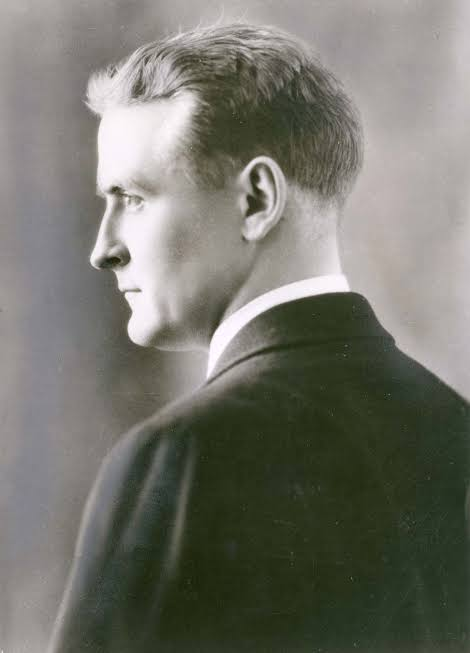

<p align="center">
    
</p>

# Fitzgeraldian

A tiny character-level GPT trained from scratch on the collected works of F. Scott Fitzgerald, then post-trained so you can talk to it.

```
you: Who is she?
fitz: She's a big bomb. He will forget you to-night.
you: Do you love her, old sport?
fitz: I can't leave him over town and have him forgotten one.
you: I think I shall go to New York.
fitz: And toke me to her into the house before they were too late.
```

It is definitely not a great conversationalist. It has only about 12M parameters, and it has read around seven books and nothing else, spelling out one character at a time. However, this is simply something I'm tinkering with for pedagogical purposes and will continually iterate to try to improve its performance.

## Why this exists

I've had experience with transformer architecture before by messing around on notebooks but never set out to actually do something with it. Given that I have an interest for literature and that I wanted to reinforce my understanding of attention, this seemed like a perfectly scaled project for me to play with. I also wanted to experience what it was like doing the dirty work of scraping a pretraining corpus alongside processing it for SFT.

The rules I set for myself:

- **No excessive library calls for the interesting parts.**  Attention, layer norm, the tokenizer, the chat template, the loss masking, and the training loops are all written out by hand.
- **Small enough to iterate on locally.** Pretraining takes under an hour on an RTX 5070 Ti. SFT takes a couple of minutes. I will potentially scale this up massively and invest some money in training on cloud GPUs, but that's a question for later


## Running it

You'll need ideally a CUDA GPU. The cleaned corpus and the SFT data are already in the repo. The checkpoints are not, so you train your own.

```bash
uv sync

# pretrain from scratch 
uv run python attention.py

# fine-tune for chat 
uv run python sft_training.py

# talk to it
uv run python chat.py
```

To rebuild the data yourself instead:

```bash
cd data && uv run python corpus_collect.py && cd ..   # download and normalize the books
uv run python data/build_sft_data.py                  # mine the chat conversations
```

## Layout

```
attention.py            the transformer and the pretraining loop
corpus.py               character tokenizer (+ chat special tokens) and batching
sft_utils.py            chat template rendering, loss masks, growing the vocab
sft_training.py         the SFT loop: batching, replay, LR schedule, eval, saving
chat.py                 loading the SFT model, sampling, and the chat REPL
data/corpus_collect.py  downloads and cleans the Gutenberg texts
data/build_sft_data.py  mines conversations out of the books
data/corpus_data.ipynb  corpus analysis (paragraph lengths and so on)
bigram.py               the original bigram model, kept for posterity
```

## What's next

Here are some things that I plan to add, just for the sake of learning

**Preference tuning and RL.** The rest of the standard post-training pipeline.
- **DPO:** sample pairs of replies from the SFT model, label the better one (by a scoring function or by hand), and tune against a frozen copy of the SFT model.
- **GRPO:** programmatic rewards, like actually stopping, staying within Fitzgerald's vocabulary, and hitting a target length or including a given word, with group-normalized advantages and a KL penalty back to the SFT model. Small models are very good at reward hacking, so the vocabulary reward is there to stop it from inventing words to game the others.

**Getting off the character level.** Most of the limitations above come back to the tokenizer. A small BPE tokenizer trained on the corpus would fit roughly four times as much text in the same context, and it would stop the model from spending most of its capacity on spelling. Doing it properly means retraining the tokenizer, pretraining again, and rebuilding the SFT data.

**A bigger, different corpus.** Seven books is not much, and the model has seen each of them about 65 times. 

**Architecture experiments to potentially try**
- Rotary embeddings, so the context can grow without retraining position tables.
- RMSNorm and the other small modern changes nanochat uses.
- **Looped transformers** 
